# Strata design system

Strata's [logo](../dev/strata-logo.png) combines a three-layer database stack with a SQL table. Its blue palette carries through the workspace. The toolbar pairs the mark with the Strata wordmark and places it on a Frost tile for legibility in both themes.

[Token definitions](../apps/desktop/src/styles/tokens.css) supply the light and dark values for the workspace, CodeMirror, and Glide. [Tailwind aliases](../apps/desktop/src/styles/globals.css) connect those values to the locally owned shadcn Nova components. The toolbar theme control cycles through system, light, and dark.

## Color

| Brand token     | Hex       |
| --------------- | --------- |
| `--brand-blue`  | `#3769D4` |
| `--brand-ink`   | `#2954AD` |
| `--brand-navy`  | `#173C6A` |
| `--brand-frost` | `#EAF2FF` |

| Semantic token         | Light     | Dark      | Apply to                                               |
| ---------------------- | --------- | --------- | ------------------------------------------------------ |
| `--background`         | `#FFFFFF` | `#101827` | Editor, result cells, main content                     |
| `--surface`            | `#F5F8FC` | `#151F31` | Toolbar, explorer, status bar, grid headers            |
| `--popover`            | `#FFFFFF` | `#1B2940` | Dialogs and floating panels                            |
| `--foreground`         | `#18243A` | `#EDF3FC` | Body text and labels                                   |
| `--muted`              | `#EDF2F8` | `#1F2D44` | Quiet controls and hover fills                         |
| `--muted-foreground`   | `#52627A` | `#A7B5CA` | Metadata, placeholders, comments, NULL values          |
| `--border`             | `#DBE3EF` | `#2B3B54` | Panel dividers and grid rules                          |
| `--input`              | `#7B8BA3` | `#69809E` | Text field and select outlines                         |
| `--primary`            | `#2954AD` | `#9AB7FF` | Primary action and active grid outline                 |
| `--primary-hover`      | `#21458F` | `#B6CAFF` | Primary action on hover                                |
| `--primary-foreground` | `#FFFFFF` | `#102045` | Text and icons on primary fills                        |
| `--ring`               | `#3769D4` | `#A2BDFF` | Keyboard focus                                         |
| `--accent`             | `#E5EEFF` | `#233A66` | Selected controls, result cells                        |
| `--accent-foreground`  | `#234A9C` | `#B8CCFF` | Selected labels and links                              |
| `--selection`          | `#A8CBFF` | `#2B56A3` | Text selection in the SQL editor                       |
| `--env-dev`            | `#176446` | `#86D5AD` | Development                                            |
| `--env-staging`        | `#805200` | `#F0C46B` | Staging                                                |
| `--env-prod`           | `#AD273C` | `#FF9AA9` | Production                                             |
| `--destructive`        | `#B12B3B` | `#FF9DA9` | Destructive controls, invalid fields, SQL diagnostics  |

CodeMirror reads the `--editor-*` and `--syntax-*` tokens. Keywords are violet, strings green, numbers copper, identifiers neutral, and functions blue. Glide resolves `--grid-*` aliases to the same palette and rebuilds its theme when the app switches modes.

## Typography and density

| Role          | Size and weight                          | Usage                                    |
| ------------- | ---------------------------------------- | ---------------------------------------- |
| Caption       | 11 px, regular                           | Status and supplemental metadata         |
| Label         | 12 px, regular or semibold               | Secondary labels, grid cells and headers |
| UI            | 13 px, regular or medium                 | Body copy, toolbar actions, fields       |
| Compact title | 15 px, semibold                          | Workspace brand and panel headings       |
| Dialog title  | 16 px, medium                            | Dialog and confirmation headings         |
| SQL           | 13 px default, regular, 1.65 line height | Editor text, adjustable in settings      |

Use the operating system's UI font with the sans-serif fallback. SQL and tabular values prefer JetBrains Mono, then Cascadia Mono, Menlo, Consolas, and the platform monospace. The font stacks use locally available fonts so the desktop app works offline.

| Foundation   | Values                                                              | Usage                                                                                     |
| ------------ | ------------------------------------------------------------------- | ----------------------------------------------------------------------------------------- |
| Spacing      | 4 px base. Common steps are 4, 8, 12, 16, 24, and 32 px.            | Icon gaps, related controls, panel insets, dialog padding                                 |
| Controls     | 28 px compact, 32 px standard                                       | Toolbar and inline actions, form fields and standard dialog buttons                       |
| Results grid | 25 px rows, 29 px header                                            | Readable, compact tabular data                                                            |
| Radius       | 6 px base                                                           | Controls. Dialogs use the larger `rounded-xl` radius.                                     |
| Icons        | Lucide, 16 px at 1.75 stroke by default                             | Pair an icon with a label or give an icon-only control an accessible name.                |
| Elevation    | Divider for docked panes, `--elevation-popover` for floating layers | Dialogs and popovers                                                                      |
| Motion       | 100 ms for dialogs and button color feedback                        | Dialog transitions and button press movement follow the system reduced-motion preference. |

## Components and states

| Component                  | Pattern                                                                                                                                           |
| -------------------------- | ------------------------------------------------------------------------------------------------------------------------------------------------- |
| Button                     | Use the filled primary variant for the main action, ghost for toolbar tools, and destructive for actions such as removing a connection.           |
| Badge                      | Use a written environment label alongside its color. A production tab also applies a strip across the top of the window.                          |
| Dialog and AlertDialog     | Use a dialog for focused tasks such as editing a connection. Use a confirmation for consequential actions such as discarding an open transaction. |
| Input, Label, NativeSelect | Pair fields with visible labels and surface invalid states next to the field.                                                                     |
| Resizable                  | Keep editor and result panes docked with a keyboard-accessible separator.                                                                         |
| CodeMirror and Glide       | Keep errors and database notices in Messages so SQL and results stay available. Use muted text for NULL values.                                   |

Use token-backed utilities in feature code and keep Base UI primitives inside the owned components. Preserve a visible keyboard focus indication and the written status for state colors.

## Milestone screenshots

These screenshots record earlier workspace milestones.

## M8 production and transactions

Production tabs show a top border and a badge. In manual mode the status bar marks open transactions and the toolbar offers Commit and Rollback.

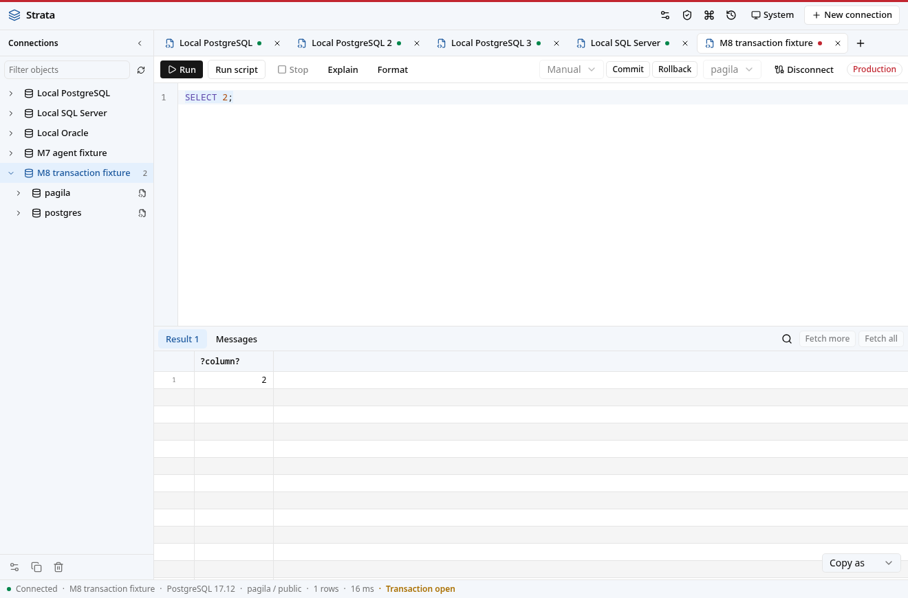

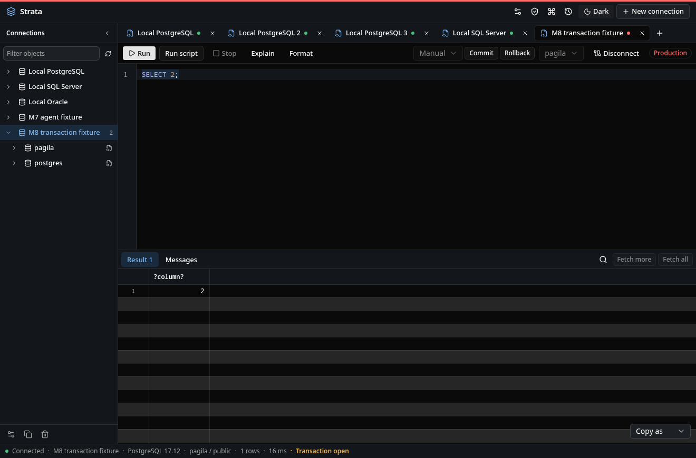

## M7 agent activity

Each entry shows the tool, decision, client, connection, and duration. When SQL is available, open it in a scratch tab.

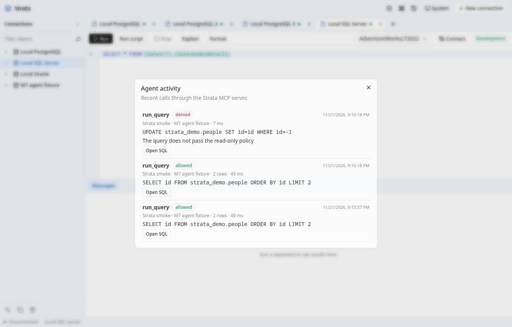

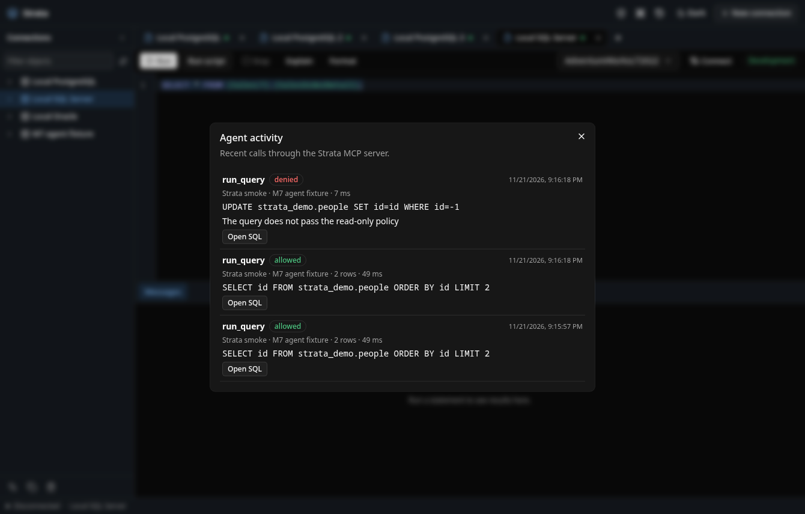

## M6 Oracle workspace

The Oracle query toolbar offers DBMS Output for the current session. The connection form accepts an EZConnect service, SID, or TNS descriptor.

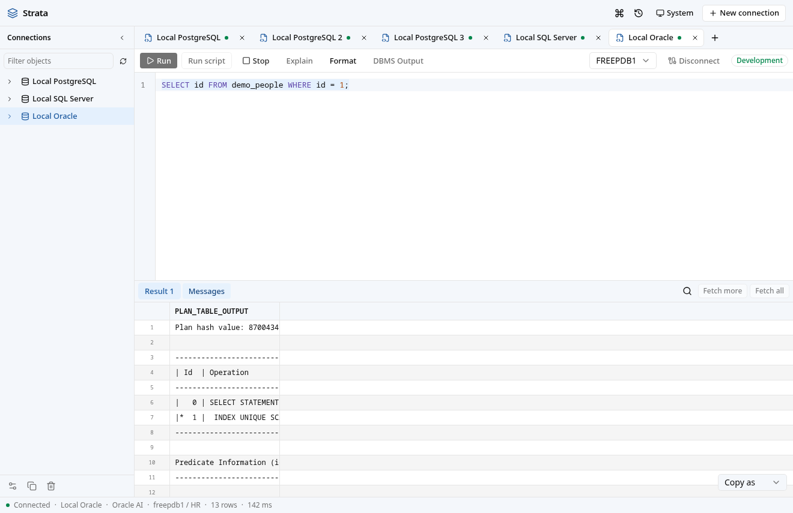

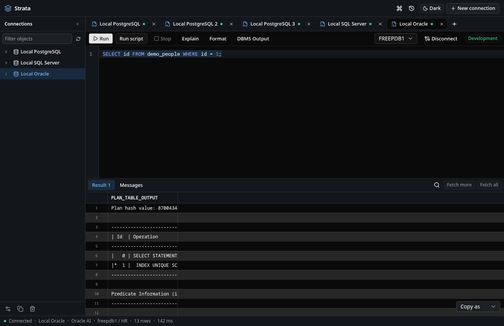

## M5 SQL Server workspace

The workspace uses the same editor and result controls for a TDS session. The editor uses the Transact-SQL dialect and Run script recognizes `GO` boundaries.

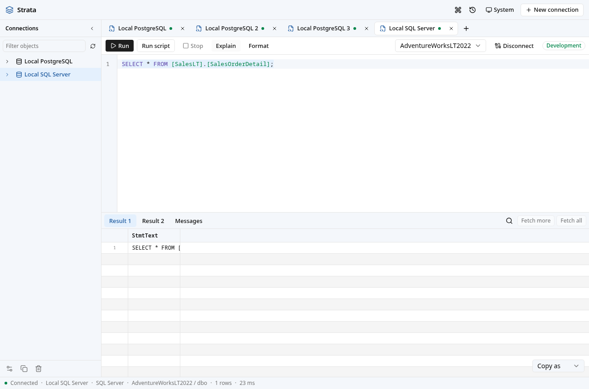

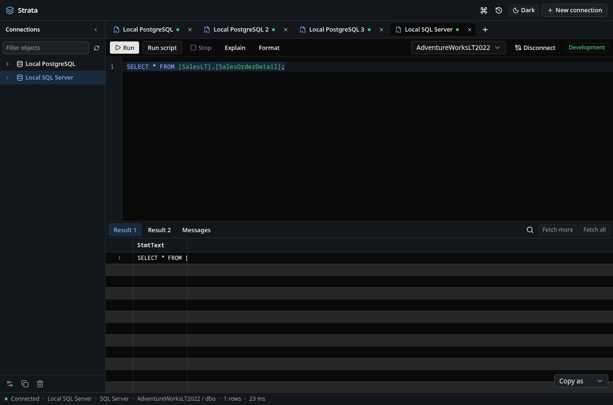

## M4 schema tab

Open related tables from the References section or the sidebar. The current tab keeps its navigation history.

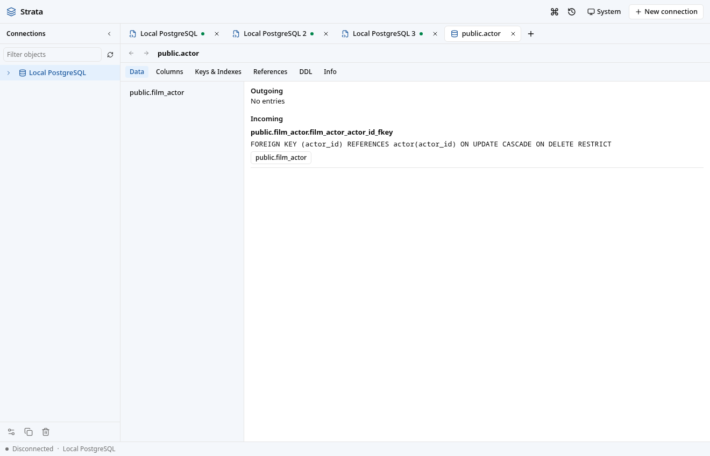

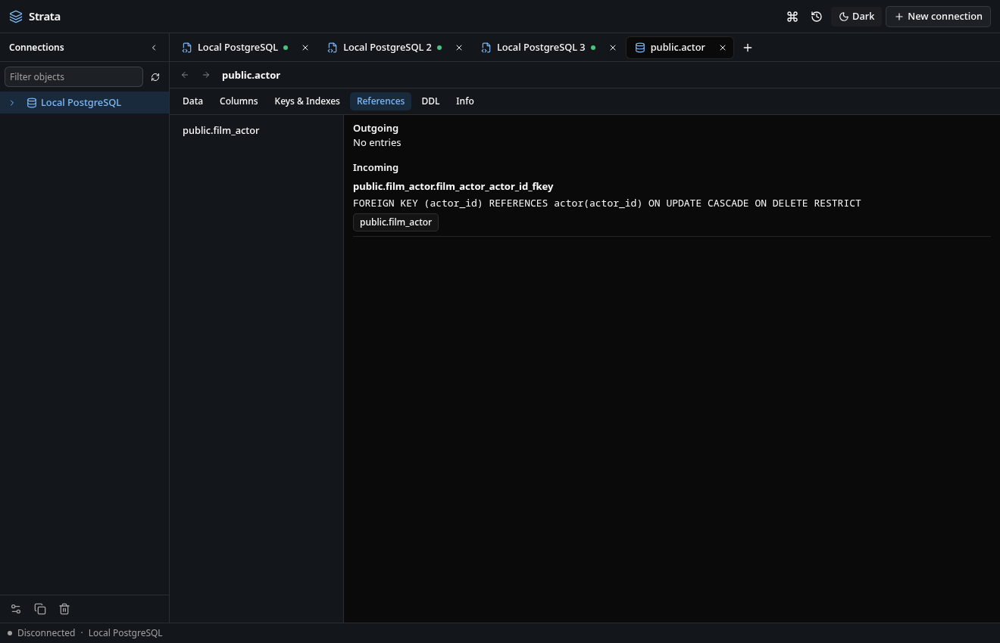

## M3 database explorer

The explorer groups loaded objects by schema and kind. Filter the loaded tree in the sidebar or use Quick open to search across loaded connections.

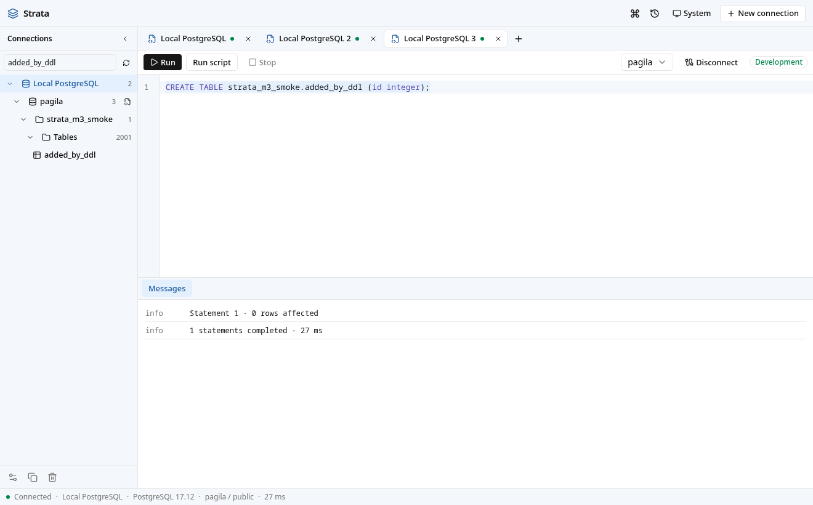

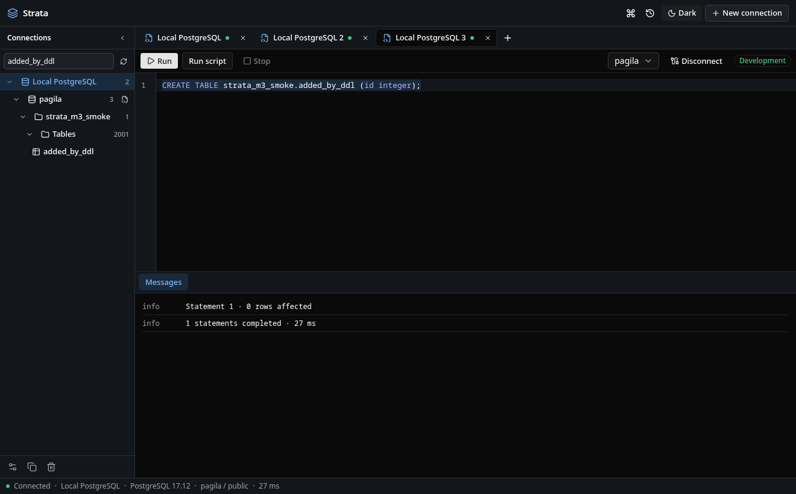

## M2 PostgreSQL workspace

## M0 workspace

