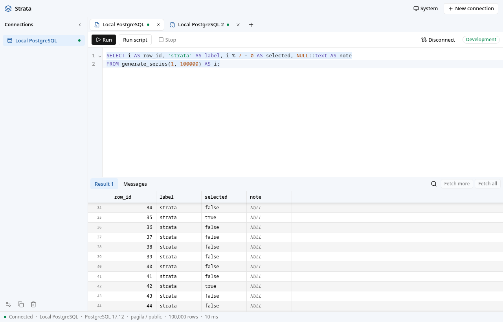
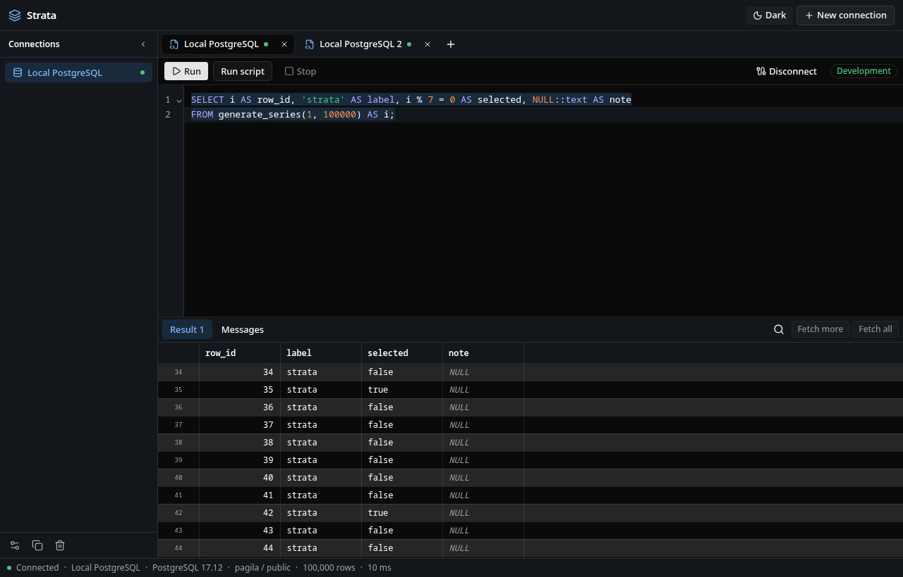
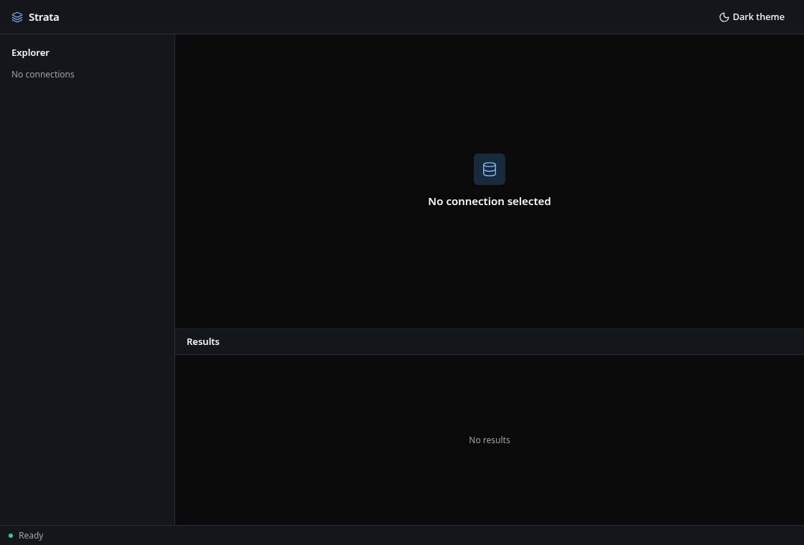

# Strata design system

The desktop workspace uses shadcn Base UI with the Nova preset and locally owned components. Strata follows the operating-system preference by default. The toolbar theme control cycles through system, light, and dark.

| Token group | Usage |
| --- | --- |
| `background`, `foreground`, `border`, `ring` | Application surfaces, text, dividers, and keyboard focus |
| `surface`, `workspace-accent`, `accent-surface` | Toolbar, explorer, status bar, and workspace icon |
| `env-dev`, `env-staging`, `env-prod` | Status and connection environment indicators |
| `grid-header`, `grid-stripe`, `grid-selection`, `grid-null` | Results grid theme |
| `editor-active-line`, `editor-statement`, `editor-selection` | SQL editor state |
| `syntax-keyword`, `syntax-string`, `syntax-number`, `syntax-comment`, `syntax-identifier`, `syntax-function` | SQL syntax colors |

The base text size is 13 px, with 12 px secondary text. Use the 4 px spacing grid, a 6 px radius, 28 px toolbar controls, and system fonts. CodeMirror and Glide use the shared monospace font stack.

| Component | Usage |
| --- | --- |
| Button, Badge | Query actions, tab actions, connection controls, and environment |
| Dialog, AlertDialog | Connection editor, password prompts, cell values, and confirmations |
| Input, Label, NativeSelect | Connection properties and result filters |
| Resizable | Keyboard and pointer resizing between the editor and results |
| CodeMirror, Glide | SQL text, syntax highlighting, and virtualized rows |

Use token-backed colors in feature code. Keep primitive imports inside the owned shadcn components. Use the environment color for the connection dot and badge. A production tab also adds an accent strip to the top of the window. Use the Messages tab for errors and database notices so the editor and results remain available.

## M2 PostgreSQL workspace

## M0 workspace

