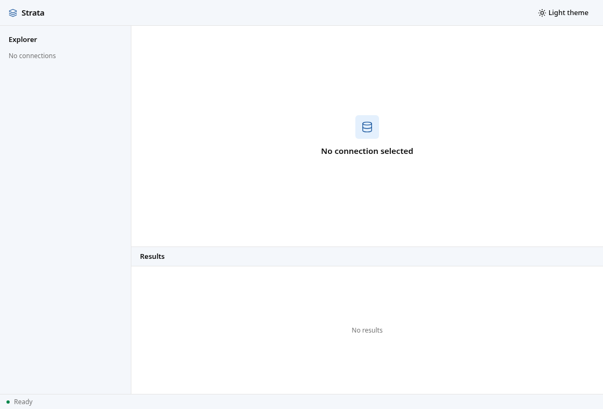

# Strata design system

The desktop workspace uses shadcn Base UI with the Nova preset and locally owned components. Strata follows the operating-system preference by default. The toolbar theme control cycles through system, light, and dark.

| Token group | Usage |
| --- | --- |
| `background`, `foreground`, `border`, `ring` | Application surfaces, text, dividers, and keyboard focus |
| `surface`, `workspace-accent`, `accent-surface` | Toolbar, explorer, status bar, and workspace icon |
| `env-dev`, `env-staging`, `env-prod` | Status and connection environment indicators |
| `grid-header`, `grid-stripe`, `grid-selection`, `grid-null` | Results grid theme |
| `editor-active-line`, `editor-statement`, `editor-selection` | SQL editor state |
| `syntax-keyword`, `syntax-string`, `syntax-number`, `syntax-comment`, `syntax-identifier`, `syntax-function` | SQL syntax colors |

The base text size is 13 px, with 12 px secondary text. Use the 4 px spacing grid, a 6 px radius, 28 px toolbar controls, and system fonts. The editor and grid will use the shared monospace font stack.

| Component | M0 usage |
| --- | --- |
| Button | Keyboard-accessible theme control |
| Workspace shell | Explorer, empty editor, results, and backend status |

Use token-backed colors in feature code. Keep primitive imports inside the owned shadcn components. The connection, editor and results components and their design examples start in M2.

## M0 workspace

